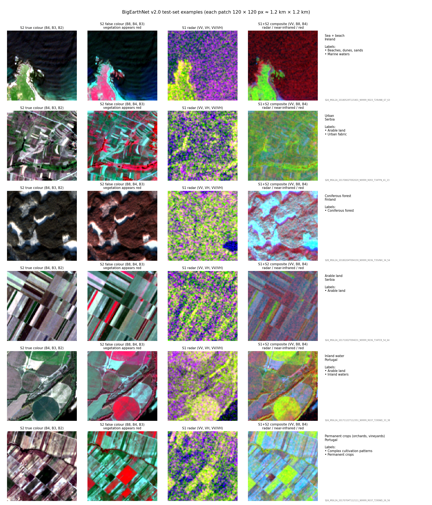
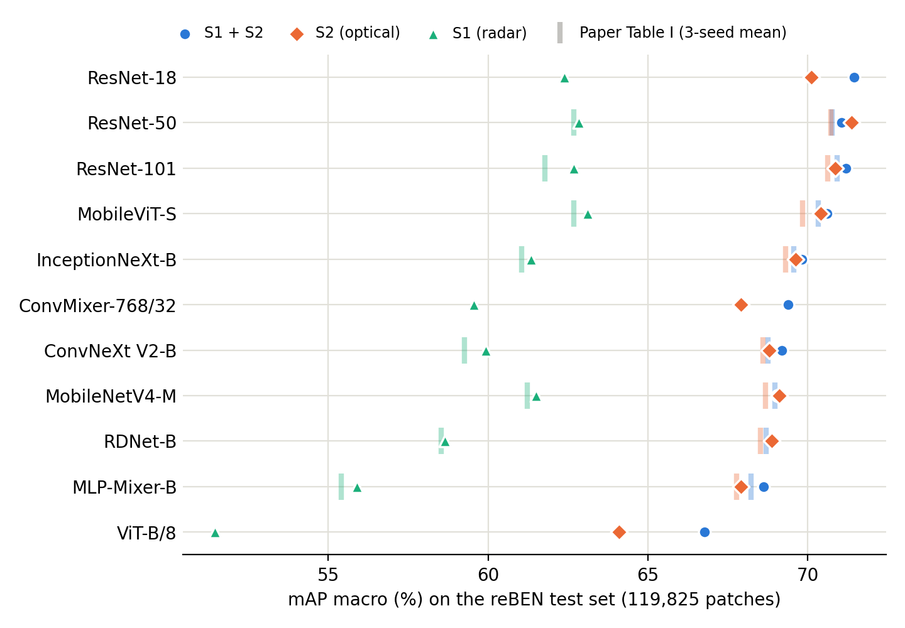
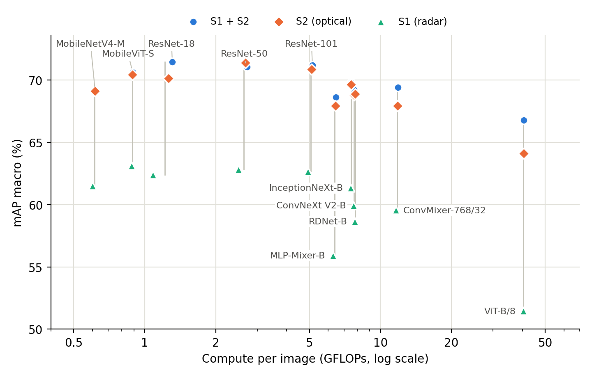

# BigEarthNet v2.0 (reBEN): Re-evaluating the Released Models

*Evaluation only: no models were trained. All numbers are on the full official test set.*

## 1. Dataset

**reBEN** (Clasen et al., IGARSS 2025, TU Berlin) is a multi-label land-cover classification benchmark.

| | |
|---|---|
| Size | 549,488 Sentinel-1 / Sentinel-2 patch pairs; **480,038** after removing snow, cloud and shadow |
| Patch | 120 × 120 px ≈ 1.2 km × 1.2 km, acquired June 2017 – May 2018 |
| Inputs | Sentinel-2 (optical) and Sentinel-1 (radar) images of the same location, see below |
| Labels | **19 land-cover classes**, derived automatically from the EU **CORINE Land Cover 2018** map; multi-label, 2.95 labels per patch on average |
| Countries | Austria, Belgium, Finland, Ireland, Kosovo, Lithuania, Luxembourg, Portugal, Serbia, Switzerland |
| Split (geographic) | train 237,871 · validation 122,342 · **test 119,825** |

**The two inputs:**

| | Sentinel-2 (S2) | Sentinel-1 (S1) |
|---|---|---|
| Sensor | Multispectral optical, passive (reflected sunlight) | Synthetic-aperture radar (SAR), active (own microwave pulse) |
| Channels used | 10 bands, visible to short-wave infrared: B02–B08, B8A, B11, B12 | 2 polarisations: VV, VH |
| What it measures | Surface reflectance, i.e. colour and vegetation properties | Backscatter (dB), i.e. surface roughness and structure |
| Resolution | 10 m (4 bands) and 20 m (6 bands, upsampled to 10 m) | 10 m |
| Clouds and night | Blocked by clouds; daytime only | Sees through clouds; day and night |
| Model input | 10 × 120 × 120 | 2 × 120 × 120 (S1 + S2: 12 × 120 × 120) |

**Labels** are very imbalanced. For example, *Arable land* has 188k patches, *Coniferous forest* 155k, *Urban fabric* 64k and *Inland waters* 63k, while *Beaches, dunes, sands* has only 1.3k.

**Figure 1.** Test-set examples. Columns: S2 true colour; S2 false colour, where vegetation appears red; S1 radar; an S1 + S2 composite (R = S1 VV, G = S2 near-infrared, B = S2 red). The model itself receives all bands stacked.

## 2. Setup

- **Models:** 11 architectures × 3 inputs (S1, S2, S1 + S2) = **33 models**. These are the authors' released v0.2.0 weights on Hugging Face (`BIFOLD-BigEarthNetv2-0`), evaluated with the official code.
- **Metric:** **mAP macro**, the paper's main metric. For each class, AP measures how well the model ranks the patches that contain that class above those that do not; mAP macro is the mean over the 19 classes, each class weighted equally.
- **Check against the official numbers:** our results match the official model cards for all 54 released models (including the older v0.1.1 versions), with a maximum difference of **0.013 points**. Paper Table I reports 3-seed means for 8 of the 11 architectures; the released single models score on average 0.35 points higher in mAP macro.

## 3. Results

**Figure 2.** mAP macro of the 33 released models. Faint bars show the paper's 3-seed mean, where available.

**Table 1.** mAP macro (%). The best value per input is in bold.

| Architecture | S1 + S2 | S2 | S1 |
|---|---|---|---|
| ResNet-18 | **71.46** | 70.12 | 62.40 |
| ResNet-50 | 71.06 | **71.37** | 62.83 |
| ResNet-101 | 71.20 | 70.87 | 62.67 |
| MobileViT-S | 70.61 | 70.42 | **63.12** |
| InceptionNeXt-B | 69.82 | 69.63 | 61.33 |
| ConvMixer-768/32 | 69.40 | 67.91 | 59.55 |
| ConvNeXt V2-B | 69.20 | 68.79 | 59.93 |
| MobileNetV4-M | 69.05 | 69.11 | 61.50 |
| RDNet-B | 68.88 | 68.87 | 58.65 |
| MLP-Mixer-B | 68.62 | 67.92 | 55.90 |
| ViT-B/8 | 66.76 | 64.10 | 51.46 |
| **Mean** | **69.64** | **69.01** | **59.94** |

## 4. Key findings

1. **Optical data dominates.** S2 beats S1 for all 11 architectures, by 9.1 points on average (range 7.3–12.7). S1 is competitive only on water: for ResNet-50, *Marine waters* scores 99.0 with S1 and 98.1 with S2. S2's advantage is largest on vegetation types, for example +22.9 points on *Permanent crops* and on *Coastal wetlands*.
2. **Fusion adds little.** S1 + S2 improves on S2 for 9 of the 11 architectures, but only by 0.6 points on average; the largest gain is for the weakest model (ViT-B/8, +2.7). Fusion is almost free for the model, because the extra channels only enter the first layer (+1–4% FLOPs, Figure 3). The real cost is on the data side: both satellites must be acquired and co-registered, and about 1.7× more data must be read per patch.
3. **Simple CNNs are best.** The top four results are ResNets and lie within 0.4 points of each other. Newer architectures (ConvNeXt V2, InceptionNeXt, RDNet, MobileNetV4, 2023–2024) do not beat ResNet. ViT-B/8 is last for every input despite costing 40 GFLOPs per image, against 1.3 for ResNet-18 (Figure 3). Our hypothesis, not yet tested, combines three causes:
   - every model is trained **from scratch**, without pretrained weights;
   - the images are **small** (120 × 120 px);
   - all models share **one set of hyperparameters**, with no per-architecture tuning.

   Transformers lack the locality bias of CNNs and usually need pretraining or much more data, so this setup favours CNNs.
4. **Rare and small classes are hard.** For ResNet-50 (S2), *Beaches, dunes, sands* scores 16.6 AP and *Coastal wetlands* 45.4. As a result, mAP macro is 14–20 points below mAP micro for every model.

**Figure 3.** Compute vs mAP macro. The three inputs of one architecture are joined by a vertical line, because they cost almost the same.

## 5. Limitations and next steps

- Each configuration has one released model, so differences below about 0.5 points are not meaningful. The paper's 3-seed means are the better reference.
- The data come from an unofficial LMDB mirror on Hugging Face, because the official Zenodo download was unreachable from our network. Reproducing the official scores exactly suggests that the content is identical.
- **Next step (tests finding 3):** fine-tune pretrained models on reBEN and compare them with the from-scratch ResNet-50:
  - an ImageNet-pretrained ViT, with its first layer adapted from 3 to 10 or 12 input channels;
  - a remote-sensing foundation model already pretrained on Sentinel data, for example SatMAE, CROMA (S1 + S2) or DOFA.

  If pretraining lifts the transformers above ResNet, finding 3 reflects the training setup rather than the architectures themselves.
